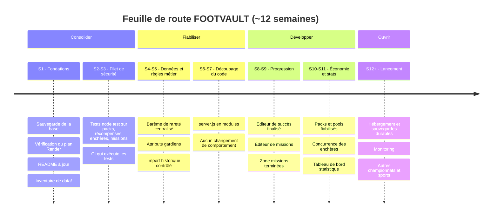

# FOOTVAULT — Point de départ et feuille de route

*État des lieux établi à partir du dépôt au 29/09/2026 (commit `4a2c8e3`). Les points marqués « à vérifier » n'ont pas pu être confirmés depuis le code seul.*

## 1. Carte d'identité technique

| Élément | Réalité dans le dépôt |
|---|---|
| Serveur | Node.js ≥ 18, module `http` natif, **sans framework** — `server.js` (~168 Ko) |
| Front-end | SPA en JavaScript vanilla, navigation par hash — `index.html`, `app.js` (~192 Ko), `styles.css` (~282 Ko), `success-admin-editor.js` |
| Dépendances | Une seule : `pg` |
| Base de données | **PostgreSQL hébergé sur Render** (`render.yaml`, variable `DATABASE_URL`). Pas de Supabase dans le code. Mode mémoire en local si `DATABASE_URL` est absente (refusé en production). |
| Schéma | Créé automatiquement au démarrage par `initDb()` dans `server.js` (23 tables : `users`, `sessions`, `catalog_cards`, `card_instances`, `pack_definitions`, `pack_pools`, `auctions`, `auction_bids`, `auction_withdrawals`, `achievements`, `reward_claims`, `clubs`, `competitions`, `competition_seasons`, `competition_clubs`, `season_clubs`, `card_collections`, `card_collection_cards`, `admin_logs`, `security_events`, `login_limits`, `registration_limits`, `app_migrations`) |
| Démarrage | `npm start` → `ligue1-launcher.js` lance `server.js` (préchargé avec `security-bootstrap.js`) puis `scripts/import-ligue1-2026-27.js` dès que les tables existent |
| Déploiement | Render, plan **free**, région Francfort, health check `/api/health` |
| CI | `.github/workflows/check.yml` : uniquement `node --check server.js` et `node --check app.js` |
| Tests | **Aucun** |

## 2. Inventaire des fonctionnalités

| Domaine | Statut | Détail |
|---|---|---|
| Comptes & sessions | ✅ | Inscription, connexion, déconnexion, limites anti-abus (`login_limits`, `registration_limits`) |
| Catalogue | ✅ | 478 cartes Ligue 1 2026-2027 (`data/footmercato_catalog_*.b64`), fallback de 24 cartes fictives |
| Collection & album | ✅ | Collection persistante, album par club avec récompense, logos de clubs |
| Packs | ✅ | Starter / Pro / Legend, tirages côté serveur avec garanties de rareté |
| Pools | 🟡 | Table `pack_pools` et route `/api/pools/open` présentes — fiabilité (stocks, répartition) à vérifier |
| Missions | 🟡 | Chaîne de 12 missions déverrouillables + tâches quotidiennes/hebdomadaires (heure de Paris). Pas d'éditeur de missions en admin |
| Succès / progression | 🟡 | Moteur en place, page Succès, éditeur admin récemment simplifié — ergonomie/aperçu/filtres à finaliser |
| Enchères | ✅ | Création, enchère, annulation, retrait, historique ; palier +10 % et prolongation d'1 min si enchère dans les 30 dernières secondes |
| Admin | ✅ | Utilisateurs, cartes, compétitions/clubs, packs, marché, journaux, succès |
| Barème de rareté | ❌ | La rareté est **stockée dans les données** ; aucune fonction n'applique le barème officiel (< 78 / 78-83 / 84-89 / 90-91 / ≥ 92) |
| Attributs gardiens | ❌ | Les GK utilisent les 6 attributs de champ ; PLG, JEU, DÉG, RÉF, VIT, POS absents |
| Historique Ligue 1 2010-2025 | 🟡 | Données présentes dans `data/` et route d'import protégée par jeton — état réel en production à vérifier |
| Tableau de bord statistique | 🟡 | Vue d'ensemble admin (`/api/admin/overview`) à enrichir |

## 3. Dettes et risques (par priorité)

1. **Risque de perte de données** — la base Postgres Render en plan free est limitée dans le temps et aucun mécanisme de sauvegarde n'est visible dans le dépôt. *À vérifier sur le tableau de bord Render.*
2. **Aucun test automatisé** — toute modification de l'économie (packs, récompenses, enchères) se fait sans filet.
3. **Documentation incohérente** — `CLAUDE.md` mentionnait Supabase (corrigé dans ce même changement) ; le `README.md` parle encore de 24 cartes.
4. **Fichiers monolithiques** — `server.js`, `app.js` et `styles.css` sont très gros avec des lignes très longues, ce qui rend les revues et les corrections risquées.
5. **Dossier `data/` encombré** — ~40 fichiers base64 avec plusieurs versions (`v2`, `v3`, `corrected`, `part…`) ; les fichiers réellement utilisés ne sont pas identifiés.
6. **Configuration de session** — `render.yaml` définit `SESSION_TTL_DAYS`, mais cette variable n'est lue nulle part : la durée est codée en dur (`SESSION_DAYS = 2/24`, soit 2 h).
7. **Règles métier non centralisées** — rareté et attributs gardiens (voir § 2).

## 4. Frise chronologique

### Détail des phases

| Phase | Période | Objectif | Terminé quand… |
|---|---|---|---|
| **0 — Fondations** | S1 | Sécuriser l'existant | Une sauvegarde de la base est faite et restaurable ; le statut du plan Render est connu ; README et CLAUDE.md décrivent la réalité ; les fichiers actifs de `data/` sont identifiés |
| **1 — Filet de sécurité** | S2-S3 | Pouvoir modifier sans casser | Des tests `node:test` (sans nouvelle dépendance) couvrent : tirages de packs et garanties, anti-double récompense, règles d'enchères (+10 %, anti-snipe), réinitialisation quotidienne/hebdomadaire ; la CI les exécute avec un smoke test sur `/api/health` |
| **2 — Données & règles métier** | S4-S5 | Un catalogue juste | Une fonction unique calcule la rareté selon le barème officiel et les 478 cartes sont auditées ; les gardiens ont leurs 6 attributs ; l'import historique 2010-2025 est contrôlé (doublons, nationalités, postes) |
| **3 — Découpage du code** | S6-S7 | Maintenabilité | `server.js` est découpé progressivement (base, auth, packs, missions, enchères, admin) sans changement de comportement, tests toujours verts |
| **4 — Progression** | S8-S9 | Priorités produit | Éditeur de succès finalisé (aperçu, validation, filtres) ; éditeur de missions en admin ; zone des missions terminées ; resets quotidien/hebdo vérifiés |
| **5 — Économie & stats** | S10-S11 | Fiabiliser l'économie | Packs et pools robustes (stocks, erreurs, idempotence) ; enchères testées en concurrence ; tableau de bord statistique enrichi |
| **6 — Lancement & suite** | S12+ | Ouvrir le projet | Hébergement et sauvegardes automatiques durables ; monitoring des erreurs ; préparation d'autres championnats puis d'autres sports |

## 5. Prochaine action concrète

Commencer la **phase 0** : faire une sauvegarde de la base Render (`pg_dump` avec la `DATABASE_URL`, depuis le tableau de bord Render) et vérifier la date d'expiration éventuelle de la base free. C'est le seul risque qui peut faire perdre des données réelles.
