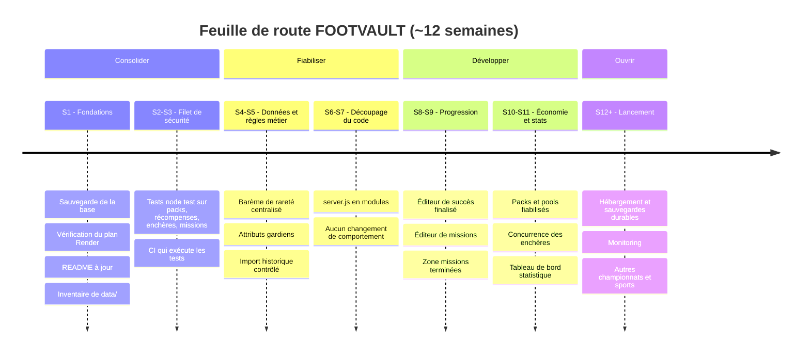

# FOOTVAULT — Point de départ et feuille de route

*État des lieux établi à partir du dépôt au 29/09/2026 (commit `4a2c8e3`). Les points marqués « à vérifier » n'ont pas pu être confirmés depuis le code seul.*

> **Mise à jour du 05/10/2026.** Ce document garde l'état du 29/09 pour l'historique (§ 1, 3, 4) ; l'inventaire du § 2 est à jour. Depuis : `server.js` est réduit à ~16 Ko (routes dans `lib/routes/`, logique dans `lib/`), 210 tests serveur et 24 tests navigateur (CI GitHub), cartes épurées avec drapeau du pays, logo du club, compétition et saison (voir [LOGOS-CLUBS.md](LOGOS-CLUBS.md)), page publique d'état du site `/etat.html` et mémoire dans `/api/health` (voir [EXPLOITATION.md](EXPLOITATION.md)), audit de sécurité ([AUDIT-SECURITE.md](AUDIT-SECURITE.md)).

## 1. Carte d'identité technique

| Élément | Réalité dans le dépôt |
|---|---|
| Serveur | Node.js ≥ 18, module `http` natif, **sans framework** — `server.js` (~168 Ko) |
| Front-end | SPA en JavaScript vanilla, navigation par hash — `index.html`, `app.js` (~192 Ko), `styles.css` (~282 Ko), `achievement-admin-editor.js`, `mission-admin-editor.js` |
| Dépendances | Une seule : `pg` |
| Base de données | **PostgreSQL hébergé sur Aiven** (Render jusqu'au 29/09/2026), connexion par la variable `DATABASE_URL` saisie dans Render. Pas de Supabase dans le code. Mode mémoire en local si `DATABASE_URL` est absente (refusé en production). |
| Schéma | Créé automatiquement au démarrage par `initDb()` dans `server.js` (23 tables : `users`, `sessions`, `catalog_cards`, `card_instances`, `pack_definitions`, `pack_pools`, `auctions`, `auction_bids`, `auction_withdrawals`, `achievements`, `reward_claims`, `clubs`, `competitions`, `competition_seasons`, `competition_clubs`, `season_clubs`, `card_collections`, `card_collection_cards`, `admin_logs`, `security_events`, `login_limits`, `registration_limits`, `app_migrations`) |
| Démarrage | `npm start` → `ligue1-launcher.js` lance `server.js` (préchargé avec `security-bootstrap.js`) puis `scripts/import-ligue1-2026-27.js` dès que les tables existent |
| Déploiement | Service web sur Render (plan **free**, Francfort), base sur Aiven, health check `/api/health` |
| CI | `.github/workflows/check.yml` : uniquement `node --check server.js` et `node --check app.js` |
| Tests | **Aucun** |

## 2. Inventaire des fonctionnalités

| Domaine | Statut | Détail |
|---|---|---|
| Comptes & sessions | ✅ | Inscription, connexion, déconnexion, limites anti-abus (`login_limits`, `registration_limits`) |
| Catalogue | ✅ | **84 751 cartes** au 05/10/2026 (`/api/health`) : Ligue 1, Premier League, La Liga, Serie A, Bundesliga (2010-11 à 2026-27), Ligue des Champions (1991-92 à 2025-26), Coupe du monde (1930-2026), Ligue des Nations (2019-2025). Fichiers dans `data/`, importés au démarrage (`scripts/import-*.js`, identifiants stables, sans doublon). Voir [data/README.md](../data/README.md) |
| Collection & album | ✅ | Collection persistante, album par club avec récompense, logos de clubs |
| Packs | ✅ | Starter / Pro / Legend, packs par compétition et par décennie, packs Coupe du monde et Ligue des Nations ; tirages côté serveur avec garanties de rareté ; animation d'ouverture (retournement par le joueur, bouton « ouvrir un autre pack ») |
| Pools | ✅ | Table `pack_pools`, route `/api/pools/open`, stocks et répartitions fiabilisés et testés (`test/packs-reliability.test.js`) |
| Missions | ✅ | Catalogue de 100 missions et tirage tournant : 3 par jour, 5 par semaine, 5 par mois (heure de Paris), plus la chaîne de missions déverrouillables ; éditeur de missions en admin (`mission-admin-editor.js`) |
| Succès / progression | ✅ | 200 succès (`lib/achievements-catalog.js`), moteur de mesure (`lib/achievement-stats.js`), page Succès, éditeur admin avec filtres et aperçu ; classement hebdomadaire et défis |
| Enchères | ✅ | Création, enchère, annulation, retrait, historique ; palier +10 % et prolongation d'1 min si enchère dans les 30 dernières secondes |
| Admin | ✅ | Utilisateurs, cartes, compétitions/clubs, packs, marché, journaux, succès |
| Barème de rareté | ✅ | *Phase 2 :* rareté calculée depuis la note par `lib/rarity.js` (création, modification, import) ; cartes spéciales à rareté manuelle (`rarity_locked`) |
| Attributs gardiens | ✅ | Affichés PLG, JEU, DÉG, RÉF, VIT, POS ; stockés dans les 6 colonnes communes (correspondance dans [QUALITE-DONNEES.md](QUALITE-DONNEES.md)). *Constat initial erroné corrigé en phase 2.* |
| Historique Ligue 1 2010-2025 | ✅ | Intégré au catalogue et vérifié en production |
| Tableau de bord statistique | ✅ | Console admin : progression, classement, export CSV (`admin-stats.js`) |

## 3. Dettes et risques (par priorité)

1. **Risque de perte de données** — *Traité en phase 0 :* sauvegarde de production faite le 29/09/2026 (23 tables, 3 utilisateurs, 334 cartes possédées, 6 938 cartes au catalogue), base migrée de Render free (expiration le 15/10/2026) vers Aiven (gratuit, sans expiration). **Reste :** Aiven gratuit n'a pas de sauvegarde automatique → sauvegardes manuelles régulières ([SAUVEGARDE.md](SAUVEGARDE.md)), à automatiser plus tard.
2. **Aucun test automatisé** — *Traité en phase 1 :* 45 tests (`npm test`, lancés par la CI). Bugs trouvés et corrigés :
   - fin d'enchère : le gagnant recevait la carte **sans être débité** (FOOTCOINS créés de rien) ; aucune vente réglée en production au 29/09/2026 ;
   - palier d'enchère faux par erreur d'arrondi (100 → 111 au lieu de 110 ; 50 → 56 ; 200 → 221), côté serveur et interface ;
   - blocage à partir de 5 inscriptions ou ouvertures de packs simultanées (connexions à la base épuisées → erreur 500) ;
   - jours de changement d'heure : début de journée des tâches décalé d'une heure.
3. **Documentation incohérente** — `CLAUDE.md` mentionnait Supabase et le `README.md` parlait de 24 cartes. *Corrigé en phase 0.*
4. **Fichiers monolithiques** — `server.js`, `app.js` et `styles.css` sont très gros avec des lignes très longues, ce qui rend les revues et les corrections risquées.
5. **Dossier `data/` encombré** — ~40 fichiers base64 avec plusieurs versions (`v2`, `v3`, `corrected`, `part…`) ; *Phase 0 : inventaire fait ([data/README.md](../data/README.md)) — seuls 3 fichiers sont lus ; suppression des anciennes versions en attente de décision.*
6. **Configuration de session** — `render.yaml` définit `SESSION_TTL_DAYS`, mais cette variable n'est lue nulle part : la durée est codée en dur (`SESSION_DAYS = 2/24`, soit 2 h).
7. **Règles métier non centralisées** — *Traité en phase 2 :* barème centralisé. **Reste :** 2 136 nationalités vides et 296 cartes aux statistiques de remplissage, à compléter depuis une source fiable ([QUALITE-DONNEES.md](QUALITE-DONNEES.md)).
8. **Import Ligue 1 cassé sur base neuve** — `scripts/import-ligue1-2026-27.js` créait la saison avec un paramètre manquant (erreur `bind message supplies 1 parameters`). Sans effet sur la prod où la saison existe déjà, mais bloquant pour une réinstallation. *Corrigé en phase 0.*

## 4. Frise chronologique

### Détail des phases

| Phase | Période | Objectif | Terminé quand… |
|---|---|---|---|
| **0 — Fondations** | S1 | Sécuriser l'existant | Une sauvegarde de la base est faite et restaurable ; le statut du plan Render est connu ; README et CLAUDE.md décrivent la réalité ; les fichiers actifs de `data/` sont identifiés |
| **1 — Filet de sécurité** | S2-S3 | Pouvoir modifier sans casser | Des tests `node:test` (sans nouvelle dépendance) couvrent : tirages de packs et garanties, anti-double récompense, règles d'enchères (+10 %, anti-snipe), réinitialisation quotidienne/hebdomadaire ; la CI les exécute avec un smoke test sur `/api/health` |
| **2 — Données & règles métier** | S4-S5 | Un catalogue juste | Une fonction unique calcule la rareté selon le barème officiel et les 478 cartes sont auditées ; les gardiens ont leurs 6 attributs ; l'import historique 2010-2025 est contrôlé (doublons, nationalités, postes) |
| **3 — Découpage du code** | S6-S7 | Maintenabilité | `server.js` est découpé progressivement (base, auth, packs, missions, enchères, admin) sans changement de comportement, tests toujours verts |
| **4 — Progression** | S8-S9 | Priorités produit | Éditeur de succès finalisé (aperçu, validation, filtres) ; éditeur de missions en admin ; zone des missions terminées ; resets quotidien/hebdo vérifiés |
| **5 — Économie & stats** | S10-S11 | Fiabiliser l'économie | Packs et pools robustes (stocks, erreurs, idempotence) ; enchères testées en concurrence ; tableau de bord statistique enrichi |
| **6 — Lancement & suite** | S12+ | Ouvrir le projet | Hébergement et sauvegardes automatiques durables ; monitoring des erreurs ; préparation d'autres championnats puis d'autres sports |

## 5. Prochaine action concrète

**Phase 0 terminée le 29/09/2026.** Base sauvegardée et migrée sur Aiven.

**Phase 1 terminée le 29/09/2026.** 45 tests automatiques, 4 bugs corrigés (voir § 3).

**Phase 2 terminée le 29/09/2026** pour le code : barème des raretés appliqué partout, 4 cartes spéciales verrouillées, poste LM converti, libellés gardiens alignés. Données à compléter en attente d'une source.

**Phase 3 terminée le 30/09/2026.** Étape 1 : modules sans état extraits dans `lib/` (configuration du jeu, périodes, règles d'enchères, barème, IP client) ; `server.js` passe de 1 121 à 1 015 lignes. Étapes suivantes : accès à la base, comptes et sessions, packs, missions et succès, enchères, administration, routeur.

Étape 2 : schéma, données de départ et migrations dans `lib/schema.js` (`initDb`) ; `server.js` à 905 lignes. Bug corrigé au passage : sur une base neuve, la création du premier admin (`ADMIN_BOOTSTRAP_PASSWORD`) échouait (table `card_instances` pas encore créée) et le serveur retombait en mode mémoire.

Étape 3 : comptes et sessions dans `lib/auth.js` (mots de passe, cookies, sessions, limites de connexion, rôles). Nouveau contrôle `npm run check` (CI) : tout identifiant non déclaré est signalé ; il a trouvé `utcDayKey`, inexistant, qui faisait planter le bonus quotidien en mode mémoire (corrigé).

Étape 4 : cartes et packs dans `lib/cards.js` (instances, tirages, packs, pools, cartes de bienvenue) ; nouveau test du tirage de pool.

Étape 5 : récompenses et progression dans `lib/rewards.js` (niveaux, bonus quotidien, missions, tâches, album) ; `server.js` à 714 lignes. Les succès, gérés directement dans les routes, suivront avec le routeur.

Hors phase, le 30/09/2026 : catalogue étendu à Premier League, La Liga, Serie A et Bundesliga (43 781 cartes, `scripts/import-europe.js`) ; site accéléré (cache du catalogue, compression) ; packs par compétition et par décennie.

Étape 6 : enchères dans `lib/auctions.js` (création, offres, anti-sniping, règlement, annulation, retrait, historique) ; `server.js` à 556 lignes.

Étape 7 : administration dans `lib/admin.js` (comptes, ressources, cartes des joueurs, catalogue, compétitions, collections, packs, journaux, vue d'ensemble) ; nouveau `test/admin.test.js` ; `server.js` à 329 lignes.

Étape 8 : routeur découpé par domaine dans `lib/routes/` (comptes, cartes et packs, progression et succès, enchères, administration, import interne) ; `json` et `readBody` dans `lib/http.js` ; nouveau `test/routes.test.js` (tour de toutes les routes, passant aussi sur l'ancien routeur). `server.js` : **1 121 → 59 lignes** (démarrage, fichiers statiques, santé, `securityEvent`).

**Phase 4 en cours.** Étape 1 : missions en base (table `missions`, reprise des 12 missions d'origine, récompenses déjà validées conservées) et éditeur de missions dans la console admin (onglet « Succès & missions ») : création avec identifiant généré, modification, activation, prérequis contrôlés (pas de boucle, jamais de chaîne bloquée), aperçu joueur. La zone des missions terminées existait déjà.

Étape 2 : éditeur de succès refait sur le modèle des missions (`lib/achievements.js`, `achievement-admin-editor.js`) : identifiant créé par le serveur (plus d'écrasement possible), erreurs par champ, aperçu joueur, filtres (statut, catégorie, condition), activation, suppression confirmée et tracée ; ancien `success-admin-editor.js` retiré.

Rapport complet du 30/09/2026 : `docs/FOOTVAULT_Rapport_30_septembre_2026.pdf` (état de départ, travaux, reste à faire, plan en 5 étapes, propositions).

**Plan, étape 1 — fiabilité de la boutique (P0).** Pack ou pool sans carte éligible : message clair (409), transaction annulée, rien débité ; l'éditeur refuse un pack ou un pool actif impossible à tirer. Pools manuels : tirage uniforme parmi les cartes sélectionnées, la composition (spéciales / rares / communes) est donc respectée. Nationalités en français partout (`lib/nations.js`, migration `nations-fr-2026-09-30` sur le catalogue et les exemplaires, import et saisie admin normalisés).

**Plan, étape 2 — identité visuelle.** Cartes v4 selon la spec (`cards-v4.css`, `cardMarkup` dans `app.js`) : 6 attributs sur la carte (libellés gardien), couleurs et motifs par rareté, holo et bordure animée Icon, filigrane du numéro masqué s'il manque, attributs masqués sous 160 px. Numéro de maillot désormais enregistré sur les exemplaires (migration `instances-jersey-2026-09-30`). Polices hébergées par le site (Barlow Condensed, Inter, Oswald ; Google Fonts était bloqué par la CSP) ; logos d'autres sites autorisés (images uniquement). Tests compétitions/clubs ; contrôle Angers/Brest 2026-2027 fait sur la sauvegarde de production (un club chacun, 22 cartes).

**Plan, étape 3 — pilotage (1/3).** Journal des FOOTCOINS (`coin_ledger`, `lib/ledger.js`) : une ligne par gain ou dépense (inscription, récompenses, packs, pools, enchères, ajustements admin), écrite dans la même transaction que le mouvement. Tableau de bord statistique dans la console (`/api/admin/stats`, `lib/stats.js`, `admin-stats.js`) : joueurs actifs 24 h / 7 j / 30 j, inscriptions, packs ouverts, flux de FC par jour et par motif, packs les plus ouverts, raretés tirées, marché, plus gros dépensiers ; période 7, 14, 30 ou 90 jours. Les soldes antérieurs au 30/09/2026 ne figurent pas dans le journal.

**Plan, étape 3 — pilotage (2/3).** Tâches quotidiennes et hebdomadaires en base (table `period_tasks`, migration `period-tasks-2026-09-30` qui reprend les 8 tâches avec leurs identifiants) et éditeur admin (`lib/tasks.js`, `task-admin-editor.js`, onglet « Succès & missions ») : création, modification, activation, aperçu joueur, nombre de récupérations. L'identifiant ne change jamais : une tâche modifiée en cours de période ne peut pas être récupérée deux fois.

**Plan, étape 3 — pilotage (3/3).** Catalogue admin paginé côté serveur (`/api/admin/cards/page`, 50 cartes par page, filtres et recherche sans accents en SQL) et résumé (`/api/admin/cards/summary` : chiffres et listes des filtres). L'ouverture de la console ne télécharge plus les 50 719 cartes (environ 30 Ko au lieu du catalogue complet) ; le catalogue complet n'est chargé qu'à l'ouverture de l'éditeur de pools, qui affiche au plus 200 cartes à la fois.

**Plan, étape 4 — expérience joueur (1/3) : notifications.** Table `notifications` (`lib/notifications.js`), écrite dans la même transaction que l'événement : surenchère (joueur dépassé), enchère remportée, carte vendue, enchère terminée sans offre. Cloche dans l'en-tête, ordinateur et mobile (`notifications-bell.js`) : compteur, liste des 30 dernières (60 jours), « tout marquer lu », nombre de récompenses à récupérer (bonus, tâches, missions) calculé à la lecture ; actualisée toutes les 60 s quand l'onglet est visible.

**Plan, étape 4 — expérience joueur (2/3) : profil.** Page `#profil` (`lib/profile.js`, `GET /api/profile`, lien depuis le Vault et le menu mobile) : identité, date d'inscription, niveau et XP, cartes, clubs, packs ouverts, FOOTCOINS ; raretés, 3 meilleures cartes, saisons ; parcours (succès, missions, tâches, albums, enchères) ; 30 derniers mouvements de FOOTCOINS avec libellés lisibles (journal tenu depuis le 30/09/2026).

**Plan, étape 4 — expérience joueur (3/3) : passe mobile et tests navigateur.** Relevé automatique de toutes les pages à 320, 390, 761 à 1240 et 1280 px : mobile et ordinateur sans débordement ; l'en-tête débordait de 60 à 170 px entre 761 et 1240 px (tablettes) : logo seul et navigation défilante sur cette plage, lien actif gardé visible. Tests navigateur en CI (`test/browser/ui.test.js`, `npm run test:browser`, `playwright-core` en dépendance de développement) sur ordinateur, tablette et mobile. **Étape 4 terminée.**

**Plan, étape 5 — exploitation.** `/api/health` indique la version déployée (commit fourni par Render) et l'état de la base ; contrôle de la production toutes les 6 heures (`.github/workflows/production.yml` : santé, pages, fichiers serveur protégés, déploiement du dernier commit) ; sauvegarde hebdomadaire chiffrée de la base (`.github/workflows/backup.yml`, secrets à configurer) ; `SESSION_TTL_DAYS` enfin pris en compte (cookie en secondes entières). Guide : `docs/EXPLOITATION.md`. Restent au propriétaire : secrets de sauvegarde, choix Render Starter ou surveillance externe, suppression de l'ancienne base Render après le 15/10. Autres compétitions : en attente de données (fichiers joueurs par saison).

**Amélioration validée — classement des collectionneurs (30/09).** Page `#classement` (`lib/leaderboard.js`, `GET /api/leaderboard`, lien dans la navigation) : score = cartes différentes possédées, pondérées par rareté (Common 1, Rare 3, Epic 8, Legendary 20, Icon 50) ; doublons, cartes offertes par l'admin et comptes bannis exclus ; classement général et de la semaine (depuis lundi minuit, heure de Paris) ; podium, rang du joueur, 50 premiers ; noms seulement (ni identifiant ni e-mail) ; recalcul au plus toutes les minutes. Pas de récompense attachée (décision économique à prendre). En-tête compact étendu jusqu'à 1 520 px pour accueillir le nouveau lien.

**Amélioration validée — albums par championnat (30/09).** En plus de la récompense de club complet (250 FC, 25 XP), récompense de saison complète (tous les clubs de l'édition : 2 000 FC, 200 XP) et de championnat entier (toutes ses saisons : 25 000 FC, 2 500 XP), montants dans `ALBUM_REWARDS` (`lib/game-config.js`). Seuls comptent les clubs qui ont des cartes au catalogue. Une récompense par joueur et par niveau (`reward_claims` : `album-season:…`, `album-competition:…`), journalisée. Les anciennes « récompenses de compétition » 25/50/100 % de l'album, purement décoratives (jamais attribuées), sont remplacées par ces trois vraies récompenses. À noter : en Ligue 1, seules les saisons ayant des clubs rattachés (2026-2027) apparaissent dans l'album ; les saisons 2010 à 2025 existent au catalogue mais n'ont pas de clubs rattachés (à configurer dans l'admin, onglet Compétitions & saisons).

**Ligue 1 historique rattachée (30/09).** Migration `ligue1-history-seasons-2026-09-30` (`lib/ligue1-history.js`, ajouts uniquement) : 16 saisons 2010-2011 à 2025-2026 créées depuis les cartes `fv-h-` et leurs clubs rattachés (clubs existants réutilisés, 20 clubs historiques créés sur la copie de production : Bordeaux, Saint-Étienne, Nantes, Reims, Caen…). Clé de club partagée entre l'album et les packs (`lib/club-key.js`), alias corrigés (« Angers SCO » = « SCO Angers », « Stade Brestois 29 » = « Stade Brestois » : l'ancien alias était mal orthographié). Effet mesuré sur la copie : l'album Ligue 1 passe de 1 à 17 saisons, le Pack Ligue 1 de 478 à 6 938 cartes (toutes les cartes de Ligue 1). Annulation possible : `DELETE FROM competition_seasons WHERE description LIKE 'Saison Ligue 1 historique%';`.

**Amélioration validée — défis thématiques (30/09).** Table `challenges` (`lib/challenges.js`, `/api/challenges`, `/api/admin/challenges`) : objectif sur une période (cartes d'un championnat, cartes obtenues, cartes Rare ou mieux, ouvertures d'un pack), récompense unique (`challenge:<id>`), récupérable jusqu'à 7 jours après la fin ; seules comptent les cartes obtenues pendant la période (hors bienvenue et dons admin). Section « Défis du moment » dans le Vault, défis prêts comptés dans la cloche, éditeur dans la console (onglet Succès & missions, `challenge-admin-editor.js`). Packs à durée limitée : colonnes `available_from` / `available_until` de `pack_definitions`, invisibles et non ouvrables hors période (rien débité), dates réglables dans l'éditeur de pack, échéance affichée en boutique. Premier défi créé au démarrage (migration `challenge-semaine-serie-a-2026-09-30`, seulement si la Serie A a des cartes) : « Semaine Serie A » (10 cartes de Serie A, 500 FC, 50 XP) avec le « Pack Semaine Serie A » (150 FC, 5 cartes dont 1 Rare ou mieux), sur la semaine en cours (lundi minuit → lundi minuit, heure de Paris).

**Améliorations des 30/09 et 01/10/2026 (PR #45 à #55).**
- Market (#45) : prix de référence (médiane des 20 dernières ventes), ventes récentes, alertes de prix (`price_alerts`, notification `price_alert`).
- Visuels (#46 à #48) : jetons de rareté, en-tête compact, podium du classement, profil rééquilibré, filtres de packs repliables, 422 sélecteurs CSS morts retirés ; libellé « Icon ».
- Cartes favorites (#49) : vitrine de 5 cartes sur le profil (`favorite_cards`, `lib/favorites.js`).
- 200 succès du document « Succès et missions » (#50) : `lib/achievements-catalog.js`, mesure groupée `lib/achievement-stats.js`, 9 succès d'origine fusionnés sans double récompense, 6 « à venir » désactivés, 25 secrets ; sauvegarde `achievement_migration_backup`.
- Nouveau logo et nouvelle page d'accueil (#51), retour au bleu nuit (#52).
- Clubs en double fusionnés (#53) : un seul club par clé (`lib/club-key.js`), rattachements transférés, nom unifié sur les cartes, exemplaires, packs et pools (`lib/club-merge.js`, migration `clubs-dedup-2026-10-01`, sauvegarde `club_merge_backup`) ; la console et l'import Europe ne recréent plus de doublon.
- 100 missions récurrentes (#54) : 40 quotidiennes, 45 hebdomadaires, 15 mensuelles (`lib/missions-catalog.js`), tirage de 3 / 5 / 5 par période, le même pour tous (`period_rotations`), période mensuelle, mesures sur la période (`lib/mission-stats.js`), pages consultées (`POST /api/activity`) ; les 8 tâches d'origine désactivées et sauvegardées. Notifications « succès débloqué » / « mission terminée » une seule fois par objectif (`lib/progress-notify.js`, `progress_notified`) avec bandeau d'annonce.
- Logos des 8 championnats hébergés par le site (#55) : `competition-<id>.png`, migration `competition-logos-2026-10-01` (logo choisi par un admin conservé, sauvegarde `competition_logo_backup`), affichés en couleurs sur pastille claire (album, saisons, console, accueil).

- Coupe du monde et Ligue des Nations (#62, 02/10/2026) : 12 586 cartes (`scripts/import-international.js`, données `data/international-2026.json.gz`), 90 sélections (« clubs » du pays International, noms français via `lib/nations.js`), 27 éditions ; notes de la Ligue des Nations conservées (le jeu n'a pas de plafond, max 99) ; notes de la Coupe du monde relevées le 02/10/2026 (courbe `LIFT` de `scripts/build-international-data.py` : médiane 66 → 75, Common 89 % → 64 %, les notes ≥ 92 ne bougent pas) ; raretés recalculées par le barème. Cartes `fv-w-`/`fv-n-` exclues des packs génériques, du cadeau de bienvenue et des cartes à la une ; packs dédiés `pack-coupe-du-monde` et `pack-ligue-des-nations` (300 FC, 6 cartes, Rare garanti, migration `packs-international-2026-10-02`). Le catalogue passe d'environ 50 700 à 63 300 cartes (mémoire du serveur Render gratuit à surveiller). Annulation : voir `data/README.md`.
- Ligue des Champions (02/10/2026) : 21 446 cartes sur 35 saisons (1991-92 à 2025-26), 160 clubs dont 96 créés (les autres réutilisent les clubs des championnats), `scripts/import-ldc.js` et `data/ldc-1991-2026.json.gz` ; notes du classeur conservées (max 97), raretés par le barème officiel (classeur : 3 % d'Icône (≥ 90) ; officiel : 1,4 % d'Icon (≥ 92) et 1,9 % de Legendary). Saison des cartes « LDC 1991-92 » (colonne `competition_seasons.season` limitée à 12 caractères). Pack dédié `pack-ligue-des-champions` (migration `packs-ldc-2026-10-02`). Le catalogue passe à 84 751 cartes ; mémoire du serveur mesurée en local : environ 156 Mo au démarrage, 230 Mo après quelques ouvertures de packs (limite Render gratuit : 512 Mo).
- Accueil, finitions et vitesse des packs (02/10/2026, #66 à #68) : l'accueil affiche « — » et un message (au lieu de « 0 cartes ») quand le serveur démarre, puis réessaie seul (2, 4, 8, 15, 30 s) ; les 8 tuiles de compétitions mènent à leur album ; descriptions des compétitions complétées (migration `competition-descriptions-2026-10-02`, descriptions vides seulement) ; **packs plus rapides** : la base est distante (~88 ms par requête en production), une ouverture de pack passe de 19 à 9 requêtes (cartes en un INSERT, débit + journal des FC en une requête, journal de sécurité après validation, empreinte du catalogue en cache `CATALOG_CACHE_MS`, 5 s ; 0 dans les tests), le catalogue Foot Mercato n'est plus réinséré carte par carte à chaque démarrage et le catalogue est préchargé au démarrage. Mesures avec 88 ms simulés : ouverture 1,8 → 0,8 s, premier tirage 12,7 → 0,9 s, serveur prêt 65 → 30 s.
- Logos de clubs (02/10/2026) : `GET /api/club-logos`, pastille ronde sur les cartes (`cards-v4.css`, `app.js`), dossier `club-logos/` servi par le site (images uniquement), `scripts/import-club-logos.js` (rapprochement par nom de club, `--list` → `docs/CLUBS-LOGOS.csv`, `--dry-run`) et `scripts/sync-club-logos.js` (rattachement au démarrage, sans écraser un logo existant). Procédure : `docs/LOGOS-CLUBS.md`. Les JPG des clubs restent à fournir par le propriétaire.
**État au 02/10/2026 :** toute la feuille de route du 30/09 est faite (tâches éditables, pagination de l'administration, notifications, profil, passe mobile, exploitation). À fournir par le propriétaire : JPG des logos de clubs (`docs/CLUBS-LOGOS.csv`, `docs/LOGOS-CLUBS.md`), nationalités des joueurs de la Ligue des Champions, décision Render Starter ou surveillance externe (`docs/EXPLOITATION.md`).

**Plan du 30/09 : étapes 1 à 5 terminées.** Pistes suivantes (à valider) : récompenses du classement, aperçu et filtres de l'éditeur de succès, fiabilisation continue des packs et pools, améliorations proposées au fil de l'eau. Restent au propriétaire : secrets de la sauvegarde automatique, suppression de l'ancienne base Render après le 15/10.

## Série de connexion quotidienne (06/10/2026)
Le bonus quotidien dépend maintenant d'une série de jours consécutifs (heure de Paris). Barème dans `DAILY_STREAK` (`lib/game-config.js`) : 150 FC + 10 XP le premier jour, +10 FC par jour de série (plafond +100 FC), palier de +500 FC au 7e jour et +2000 FC au 30e jour ; un jour manqué remet la série à 1 (le record est conservé). Calcul côté serveur dans `lib/daily-streak.js`, appliqué par `claimDaily` (`lib/rewards.js`) sous le verrou de la ligne utilisateur (un seul bonus par jour, même en rafale). Colonnes `users.daily_streak` et `users.best_streak` (ajout idempotent dans `lib/schema.js`, valeur 0 par défaut). Annulation : `git revert` ; les colonnes ajoutées peuvent rester sans effet.

## Découpage de l'interface : espace de noms FVC (06/10/2026, étape Q0)
`app.js` crée `window.FVC` : `FVC.pages` (une fonction par page — `home`, `collection`, `packs`, `vault`, `profil`, `classement`, `successes`, `album`, `card`, `auth`, `market`, `admin` — qui reçoit les paramètres du lien et renvoie le HTML) et `FVC.core` (aides partagées : `state`, `$`, `app`, `esc`, `money`, `initials`, `api`, `render`, `toast`, `setModal`, `closeModal`, `cardMarkup`). `render()` consulte `FVC.pages` : un script chargé après `app.js` peut remplacer une page (étapes suivantes : `fv-admin.js`, `fv-market.js`). Un lien inconnu affiche maintenant l'accueil (avant : « [object Promise] »). Un script ajouté doit figurer dans `PUBLIC_SCRIPTS` (`server.js`) et dans `index.html` avec son `?v=`. Test : `test/browser/ui.test.js` (espace de noms) ; seuil de taille de `app.js` abaissé dans `test/static.test.js` (le fichier va diminuer).
