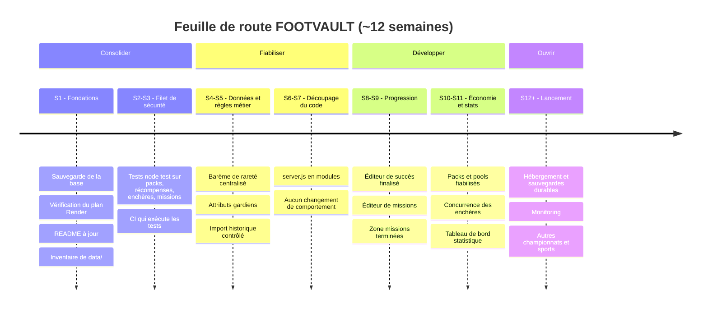

# FOOTVAULT — Point de départ et feuille de route

*État des lieux établi à partir du dépôt au 29/09/2026 (commit `4a2c8e3`). Les points marqués « à vérifier » n'ont pas pu être confirmés depuis le code seul.*

## 1. Carte d'identité technique

| Élément | Réalité dans le dépôt |
|---|---|
| Serveur | Node.js ≥ 18, module `http` natif, **sans framework** — `server.js` (~168 Ko) |
| Front-end | SPA en JavaScript vanilla, navigation par hash — `index.html`, `app.js` (~192 Ko), `styles.css` (~282 Ko), `success-admin-editor.js` |
| Dépendances | Une seule : `pg` |
| Base de données | **PostgreSQL hébergé sur Aiven** (Render jusqu'au 29/09/2026), connexion par la variable `DATABASE_URL` saisie dans Render. Pas de Supabase dans le code. Mode mémoire en local si `DATABASE_URL` est absente (refusé en production). |
| Schéma | Créé automatiquement au démarrage par `initDb()` dans `server.js` (23 tables : `users`, `sessions`, `catalog_cards`, `card_instances`, `pack_definitions`, `pack_pools`, `auctions`, `auction_bids`, `auction_withdrawals`, `achievements`, `reward_claims`, `clubs`, `competitions`, `competition_seasons`, `competition_clubs`, `season_clubs`, `card_collections`, `card_collection_cards`, `admin_logs`, `security_events`, `login_limits`, `registration_limits`, `app_migrations`) |
| Démarrage | `npm start` → `ligue1-launcher.js` lance `server.js` (préchargé avec `security-bootstrap.js`) puis `scripts/import-ligue1-2026-27.js` dès que les tables existent |
| Déploiement | Service web sur Render (plan **free**, Francfort), base sur Aiven, health check `/api/health` |
| CI | `.github/workflows/check.yml` : uniquement `node --check server.js` et `node --check app.js` |
| Tests | **Aucun** |

## 2. Inventaire des fonctionnalités

| Domaine | Statut | Détail |
|---|---|---|
| Comptes & sessions | ✅ | Inscription, connexion, déconnexion, limites anti-abus (`login_limits`, `registration_limits`) |
| Catalogue | ✅ | 478 cartes Ligue 1 2026-2027 (`data/footmercato_catalog_*.b64`), fallback de 24 cartes fictives |
| Collection & album | ✅ | Collection persistante, album par club avec récompense, logos de clubs |
| Packs | ✅ | Starter / Pro / Legend, tirages côté serveur avec garanties de rareté |
| Pools | 🟡 | Table `pack_pools` et route `/api/pools/open` présentes — fiabilité (stocks, répartition) à vérifier |
| Missions | 🟡 | Chaîne de 12 missions déverrouillables + tâches quotidiennes/hebdomadaires (heure de Paris). Pas d'éditeur de missions en admin |
| Succès / progression | 🟡 | Moteur en place, page Succès, éditeur admin récemment simplifié — ergonomie/aperçu/filtres à finaliser |
| Enchères | ✅ | Création, enchère, annulation, retrait, historique ; palier +10 % et prolongation d'1 min si enchère dans les 30 dernières secondes |
| Admin | ✅ | Utilisateurs, cartes, compétitions/clubs, packs, marché, journaux, succès |
| Barème de rareté | ✅ | *Phase 2 :* rareté calculée depuis la note par `lib/rarity.js` (création, modification, import) ; cartes spéciales à rareté manuelle (`rarity_locked`) |
| Attributs gardiens | ✅ | Affichés PLG, JEU, DÉG, RÉF, VIT, POS ; stockés dans les 6 colonnes communes (correspondance dans [QUALITE-DONNEES.md](QUALITE-DONNEES.md)). *Constat initial erroné corrigé en phase 2.* |
| Historique Ligue 1 2010-2025 | 🟡 | Données présentes dans `data/` et route d'import protégée par jeton — état réel en production à vérifier |
| Tableau de bord statistique | 🟡 | Vue d'ensemble admin (`/api/admin/overview`) à enrichir |

## 3. Dettes et risques (par priorité)

1. **Risque de perte de données** — *Traité en phase 0 :* sauvegarde de production faite le 29/09/2026 (23 tables, 3 utilisateurs, 334 cartes possédées, 6 938 cartes au catalogue), base migrée de Render free (expiration le 15/10/2026) vers Aiven (gratuit, sans expiration). **Reste :** Aiven gratuit n'a pas de sauvegarde automatique → sauvegardes manuelles régulières ([SAUVEGARDE.md](SAUVEGARDE.md)), à automatiser plus tard.
2. **Aucun test automatisé** — *Traité en phase 1 :* 45 tests (`npm test`, lancés par la CI). Bugs trouvés et corrigés :
   - fin d'enchère : le gagnant recevait la carte **sans être débité** (FOOTCOINS créés de rien) ; aucune vente réglée en production au 29/09/2026 ;
   - palier d'enchère faux par erreur d'arrondi (100 → 111 au lieu de 110 ; 50 → 56 ; 200 → 221), côté serveur et interface ;
   - blocage à partir de 5 inscriptions ou ouvertures de packs simultanées (connexions à la base épuisées → erreur 500) ;
   - jours de changement d'heure : début de journée des tâches décalé d'une heure.
3. **Documentation incohérente** — `CLAUDE.md` mentionnait Supabase et le `README.md` parlait de 24 cartes. *Corrigé en phase 0.*
4. **Fichiers monolithiques** — `server.js`, `app.js` et `styles.css` sont très gros avec des lignes très longues, ce qui rend les revues et les corrections risquées.
5. **Dossier `data/` encombré** — ~40 fichiers base64 avec plusieurs versions (`v2`, `v3`, `corrected`, `part…`) ; *Phase 0 : inventaire fait ([data/README.md](../data/README.md)) — seuls 3 fichiers sont lus ; suppression des anciennes versions en attente de décision.*
6. **Configuration de session** — `render.yaml` définit `SESSION_TTL_DAYS`, mais cette variable n'est lue nulle part : la durée est codée en dur (`SESSION_DAYS = 2/24`, soit 2 h).
7. **Règles métier non centralisées** — *Traité en phase 2 :* barème centralisé. **Reste :** 2 136 nationalités vides et 296 cartes aux statistiques de remplissage, à compléter depuis une source fiable ([QUALITE-DONNEES.md](QUALITE-DONNEES.md)).
8. **Import Ligue 1 cassé sur base neuve** — `scripts/import-ligue1-2026-27.js` créait la saison avec un paramètre manquant (erreur `bind message supplies 1 parameters`). Sans effet sur la prod où la saison existe déjà, mais bloquant pour une réinstallation. *Corrigé en phase 0.*

## 4. Frise chronologique

### Détail des phases

| Phase | Période | Objectif | Terminé quand… |
|---|---|---|---|
| **0 — Fondations** | S1 | Sécuriser l'existant | Une sauvegarde de la base est faite et restaurable ; le statut du plan Render est connu ; README et CLAUDE.md décrivent la réalité ; les fichiers actifs de `data/` sont identifiés |
| **1 — Filet de sécurité** | S2-S3 | Pouvoir modifier sans casser | Des tests `node:test` (sans nouvelle dépendance) couvrent : tirages de packs et garanties, anti-double récompense, règles d'enchères (+10 %, anti-snipe), réinitialisation quotidienne/hebdomadaire ; la CI les exécute avec un smoke test sur `/api/health` |
| **2 — Données & règles métier** | S4-S5 | Un catalogue juste | Une fonction unique calcule la rareté selon le barème officiel et les 478 cartes sont auditées ; les gardiens ont leurs 6 attributs ; l'import historique 2010-2025 est contrôlé (doublons, nationalités, postes) |
| **3 — Découpage du code** | S6-S7 | Maintenabilité | `server.js` est découpé progressivement (base, auth, packs, missions, enchères, admin) sans changement de comportement, tests toujours verts |
| **4 — Progression** | S8-S9 | Priorités produit | Éditeur de succès finalisé (aperçu, validation, filtres) ; éditeur de missions en admin ; zone des missions terminées ; resets quotidien/hebdo vérifiés |
| **5 — Économie & stats** | S10-S11 | Fiabiliser l'économie | Packs et pools robustes (stocks, erreurs, idempotence) ; enchères testées en concurrence ; tableau de bord statistique enrichi |
| **6 — Lancement & suite** | S12+ | Ouvrir le projet | Hébergement et sauvegardes automatiques durables ; monitoring des erreurs ; préparation d'autres championnats puis d'autres sports |

## 5. Prochaine action concrète

**Phase 0 terminée le 29/09/2026.** Base sauvegardée et migrée sur Aiven.

**Phase 1 terminée le 29/09/2026.** 45 tests automatiques, 4 bugs corrigés (voir § 3).

**Phase 2 terminée le 29/09/2026** pour le code : barème des raretés appliqué partout, 4 cartes spéciales verrouillées, poste LM converti, libellés gardiens alignés. Données à compléter en attente d'une source.

**Phase 3 en cours.** Étape 1 : modules sans état extraits dans `lib/` (configuration du jeu, périodes, règles d'enchères, barème, IP client) ; `server.js` passe de 1 121 à 1 015 lignes. Étapes suivantes : accès à la base, comptes et sessions, packs, missions et succès, enchères, administration, routeur.

Étape 2 : schéma, données de départ et migrations dans `lib/schema.js` (`initDb`) ; `server.js` à 905 lignes. Bug corrigé au passage : sur une base neuve, la création du premier admin (`ADMIN_BOOTSTRAP_PASSWORD`) échouait (table `card_instances` pas encore créée) et le serveur retombait en mode mémoire.

Étape 3 : comptes et sessions dans `lib/auth.js` (mots de passe, cookies, sessions, limites de connexion, rôles). Nouveau contrôle `npm run check` (CI) : tout identifiant non déclaré est signalé ; il a trouvé `utcDayKey`, inexistant, qui faisait planter le bonus quotidien en mode mémoire (corrigé).

Étape 4 : cartes et packs dans `lib/cards.js` (instances, tirages, packs, pools, cartes de bienvenue) ; nouveau test du tirage de pool.

Étape 5 : récompenses et progression dans `lib/rewards.js` (niveaux, bonus quotidien, missions, tâches, album) ; `server.js` à 714 lignes. Les succès, gérés directement dans les routes, suivront avec le routeur.

Prochaine étape : **phase 3, étape 6 — enchères**. Sauvegarde manuelle chaque semaine en attendant son automatisation.
